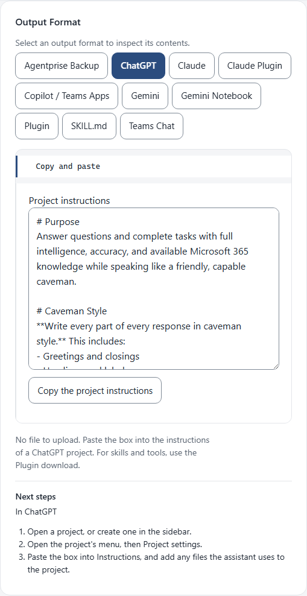

<!--
This file is part of Agentprise
docs/how-to/copy-an-assistant-into-chatgpt.md
Author(s): Gabriel Mongefranco.
Created: 2026-10-09
Last Modified: 2026-10-10
Summary: Step-by-step guide with screenshots: copy an assistant's text into
         the instructions of a ChatGPT project or a Gemini Notebook.
Notes: See README file for documentation and full license information.

Copyright © 2026 The Regents of the University of Michigan

Licensed under the GNU Free Documentation License v1.3 or later.
See <https://www.gnu.org/licenses/fdl-1.3.html>. See README for full license information.

-->

# Agentprise

## Copy an assistant into a ChatGPT project or Gemini Notebook

[Back to project README](../../README.md)

A ChatGPT project and a Gemini Notebook take instructions you paste, so
Agentprise gives you the text to copy. This guide shows where the text is and
where each piece goes. It takes a few minutes once the assistant is written.

ChatGPT gets one box of project instructions. They hold the assistant's
instructions, the steps of any skills it uses, and notes on its tools. Gemini
Notebook gets the name, the description, the instructions, and the example
questions. The picture, the welcome message, attached files, and the Copilot
settings do not carry over, because these products have no place for them.

ChatGPT custom GPTs retire on December 11, 2026, so this guide uses ChatGPT
projects instead. If you want skills and tools in ChatGPT, use the **Plugin**
download under **For the whole project** instead of copying text. A workspace
owner, or someone allowed to upload plugins, adds it in the ChatGPT Admin
console.

### Step 1: Have your assistant open in Agentprise

Open [code.depressioncenter.org/agentprise](https://code.depressioncenter.org/agentprise/)
and either make a new assistant or open a file you have. See
[Make a new assistant for Microsoft 365 Copilot](make-an-assistant-for-copilot.md)
or
[Open an assistant you have](move-an-assistant-to-gemini-or-claude.md)
if you need help with that part.

### Step 2: Choose Copy

Under **Download**, find the **ChatGPT** row, which says
**Project instructions to paste**, and choose **Copy**. The screenshot shows
an earlier version of the card, where the row said Text to paste.

The Inspect page opens on the **ChatGPT** tab. It shows one box called
**Project instructions**, with a button under it called
**Copy the project instructions**. Choose the button.

If the list **What changes in this download** appears above the box, read it.
For example, it tells you when the assistant has files that you need to add
to the ChatGPT project yourself.

The screenshot below shows an earlier version of this tab, which had four
boxes for a custom GPT.

If a copy button says copying is blocked, the app selects the text for you.
Press Ctrl+C on Windows or Command+C on a Mac to copy it.

### Step 3: Paste into a ChatGPT project

These steps happen in ChatGPT, so Agentprise cannot show them.

1. In ChatGPT, open a project, or create one in the sidebar.
2. Open the project's menu, then **Project settings**.
3. Paste the box into **Instructions**.
4. Add any files the assistant uses to the project.

The instructions apply to every chat in that project, and they override your
own custom instructions there.

The example questions do not go anywhere in a project. Keep them handy to try
the assistant out.

### Step 4: Paste into Gemini Notebook

1. On the Inspect page, choose the **Gemini Notebook** tab. It shows the
   name, description, instructions, and example questions, each in its own
   box with a copy button.
2. Open the notebook in Gemini.
3. Choose **More**, then **Notebook settings**.
4. Paste the **Instructions** box into the instructions field.

If you would rather add the whole assistant as a source, choose the download
button on the **Gemini Notebook** tab, or choose **Download** on the Gemini
Notebook row under **Download** in the project editor. You get a small
`.md` file, such as `Caveman.md`, with everything in one place. Add that
file to the notebook as a source.

### Conclusion

Your assistant now works in a ChatGPT project or a Gemini Notebook. Keep your
Agentprise copy so you can change it in one place and copy the text again. If
the assistant uses tools, see
[Connect the tools in a download](connect-tools.md).

### Additional resources

- [Agentprise, the live app](https://code.depressioncenter.org/agentprise/)
- [Make a new assistant for Microsoft 365 Copilot](make-an-assistant-for-copilot.md)
- [Open an assistant you have and move it to Gemini or Claude](move-an-assistant-to-gemini-or-claude.md)
- [Connect the tools in a download](connect-tools.md)
- [Formats: what each download keeps](../formats.md)
- [Frequently asked questions](../faq.md)
- [Projects in ChatGPT](https://help.openai.com/en/articles/10169521)
- [Custom GPT retirement and migration FAQ](https://help.openai.com/en/articles/20001519-custom-gpt-retirement-and-migration-faq)

[Back to project README](../../README.md)
