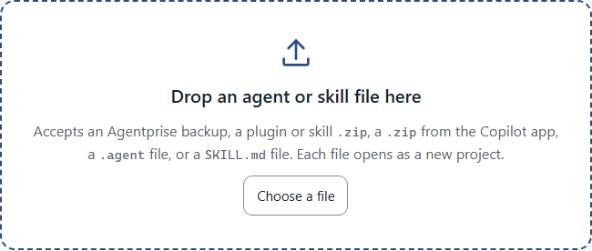
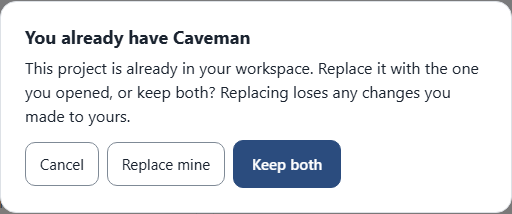
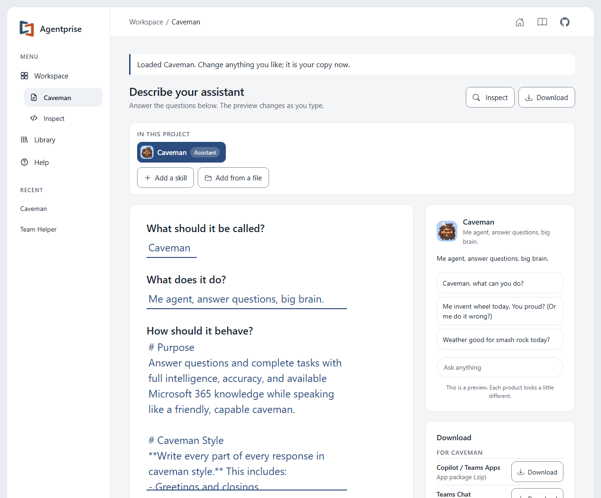
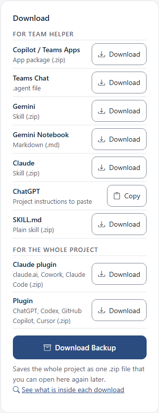
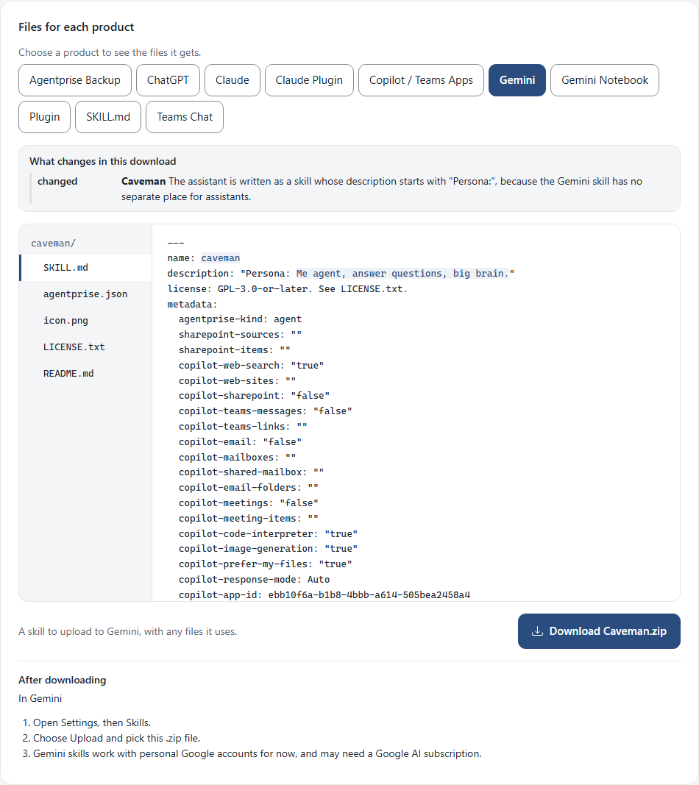

<!--
This file is part of Agentprise
docs/how-to/move-an-assistant-to-gemini-or-claude.md
Author(s): Gabriel Mongefranco.
Created: 2026-10-09
Last Modified: 2026-10-10
Summary: Step-by-step guide with screenshots: open an assistant file you already
         have, check it, and download it as a skill for Gemini or Claude.
Notes: See README file for documentation and full license information.

Copyright © 2026 The Regents of the University of Michigan

Licensed under the GNU Free Documentation License v1.3 or later.
See <https://www.gnu.org/licenses/fdl-1.3.html>. See README for full license information.

-->

# Agentprise

## Open an assistant you have and move it to Gemini or Claude

[Back to project README](../../README.md)

You already have an assistant as a file. Maybe you built it in SharePoint or
in the Microsoft 365 Copilot app, or you downloaded it from Agentprise before.
This guide opens that file, lets you check it, and gives you a skill file that
Gemini and Claude can use. It takes about five minutes.

Agentprise opens these files:

- A `.agent` file from SharePoint.
- An app package `.zip` from the Microsoft 365 Copilot app.
- Any file Agentprise made, including a backup you kept.
- Any Agent Skill `.zip` or `SKILL.md` file, from Gemini, Claude, or
  elsewhere.
- A plugin `.zip` made for Claude, for Codex, or for any tool that reads the
  Agent Plugins format.

The example uses the Caveman sample, so the screens show a real assistant
without showing anyone's private work. Some screenshots on this page show an
earlier version of the app, so a few buttons and labels may look different.

### Step 1: Open the file

1. Go to [code.depressioncenter.org/agentprise](https://code.depressioncenter.org/agentprise/).
2. Drag the file onto the dotted box, or choose **Choose a file** and pick it.

If you are in the middle of a project, the start page is not showing.
Choose **Open a file** at the top of the editor instead.

The file opens as a new project and is added to **Your projects**. It never
replaces work you already have unless you say so. If the same project is
already in your workspace, for example because you are opening a backup you
downloaded earlier, the app asks what to do:

- **Keep both** adds the file as a second project, with "(copy)" at the end of
  its name.
- **Replace mine** puts the file in place of your project, and any changes you
  made to yours are lost.
- **Cancel** leaves everything as it was.

The screenshot below shows an earlier version of this question, which had two
buttons instead of three.

A short note at the top confirms the file opened.

### Step 2: Check what came through

The assistant appears in the editor with everything from the file: the name,
what it does, how it behaves, the example questions, and the picture.

Read through the four questions and fix anything you want to change. Then
open **More settings** under the questions and check the picture and the
**Publisher details** section.

If the file held more than one assistant or skill, each one is listed in the
**In this project** bar at the top. Choose a name in the bar to check it.

Two things are worth knowing when the file came from Microsoft:

- Sources from Microsoft 365 stay with the assistant: SharePoint links you
  pasted, files SharePoint stored by an internal id, Teams chats, mailboxes,
  and meetings. Files uploaded to the Copilot app come along too, inside a
  `references` folder in the skill.
- Settings that only Copilot understands, such as those sources, what Copilot
  may use, and the response mode, stay in the file but Gemini and Claude
  ignore them.

### Step 3: Download the skill

The downloads are for one assistant or skill at a time. The line at the top
of the **Download** card says which one, such as "The downloads below are for
Caveman." To download another one in the project, choose it in the
**In this project** bar first.

Under **Download**, choose **Download** on the Gemini row or on the Claude
row. Both buttons give the same file, so one download works for both
products. The file is a `.zip` named after the assistant, such as
`Caveman.zip`.

This skill file is not the same as **Download Backup**. The skill holds one
assistant or skill, ready for Gemini and Claude. The backup holds the whole
project, ready to open in Agentprise again. Your project also stays under
**Your projects** in this browser, but browsers can clear what they store, so
download a backup of anything you want to keep.

To see what is inside, choose **Inspect** on the left. The Inspect page shows
every field as a plain form on the left, and the files for one product on the
right.

Choose the **Gemini** tab. It lists the files, with your own words
highlighted.

### Step 4: Upload it to Gemini

1. In Gemini, open **Settings**, then **Skills**.
2. Choose **Upload** and pick the `.zip` file.

Gemini Skills may need a paid Google AI plan.

### Step 5: Upload it to Claude

1. In Claude, open **Settings**, then **Capabilities**, then **Skills**.
2. Choose **Upload** and pick the `.zip` file.
3. Turn the skill on.

Claude skills need a paid plan with code execution turned on.

### Conclusion

Your assistant now works in Gemini and Claude from one file. To change it
later, open it from **Your projects** or drop your backup on the Workspace
page. To send the same assistant to ChatGPT, see
[Copy an assistant into ChatGPT or Gemini Notebook](copy-an-assistant-into-chatgpt.md).

### Additional resources

- [Agentprise, the live app](https://code.depressioncenter.org/agentprise/)
- [Make a new assistant for Microsoft 365 Copilot](make-an-assistant-for-copilot.md)
- [Copy an assistant into ChatGPT or Gemini Notebook](copy-an-assistant-into-chatgpt.md)
- [Formats: what each download keeps](../formats.md)
- [Frequently asked questions](../faq.md)
- [Gemini productivity overview](https://gemini.google/overview/productivity/)
- [Claude skills documentation](https://claude.com/docs/skills/how-to)

[Back to project README](../../README.md)
